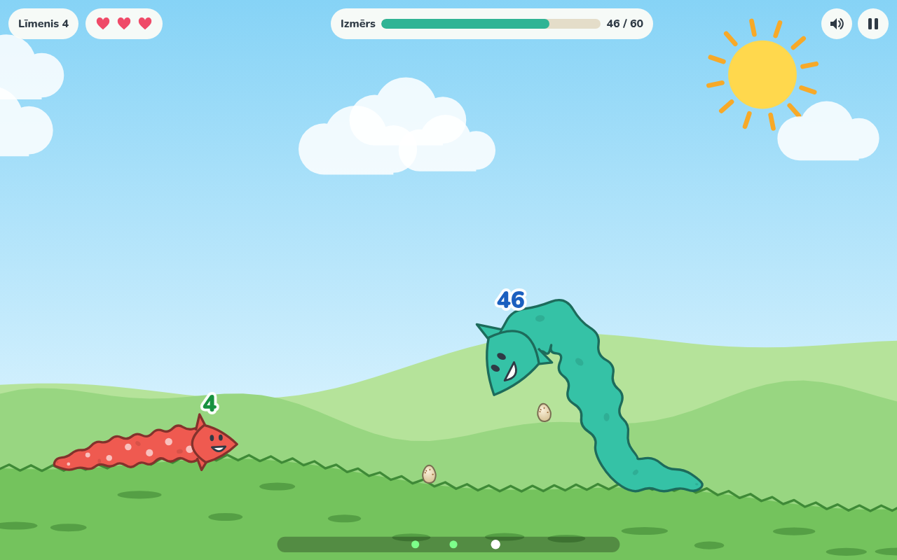

# Čūskamēba / Amoeba Snake

A side-view browser game for children: a snake that looks a bit like an amoeba eats food and
smaller snakes, and grows until it reaches the level's target size. Latvian by default, with an
English switch. Based on `task.md` and a pencil sketch.

## Run

Open `index.html` in a browser. No server, build step or network is needed: the font is embedded,
and all pictures and sounds are generated in code.

## How it plays

Start with the tutorial, which teaches one thing at a time and follows an orange arrow. After that,
pick a level, choose your snake's pattern and colour, and grow to the target size to win and unlock
the next level.

| Control | Keyboard | Mouse or touch |
|---|---|---|
| Move | Left/Right arrows or A/D | hold left or right of the head |
| Hop, or climb a tree | Up arrow, W or Space | hold well above the head |
| Climb down, drop off a ledge | Down arrow or S | hold well below the head |
| Pause | Esc or P | pause button |

- **Size** is the number above each head. Other snakes' numbers are red if bigger than you (run),
  green if smaller (eat them) and yellow if equal.
- **Food:** snake eggs. Small ones give +1, big ones +5, and a rare golden one +10. They lie on the
  ground, float within hopping height, and sit in trees and on rock ledges.
- **Shrinking:** every snake loses size at a steady rate, faster on later levels.
- **Turning:** a snake has to lose its speed before it can go the other way, which takes about 0.7
  seconds at full speed. Trees are the exception: a climbing snake grips and can move at once.
- **Meeting:** when two heads touch, the smaller snake bursts into round pieces in its own colour,
  worth about 60% of its size. Bigger snakes leave bigger pieces. The winner gains nothing until it
  eats them, rivals can take them too, and they vanish after 25 seconds. Equal sizes bounce apart.
  Bodies slide past each other, so hop over a head to escape.
- **Trees** are harmless and can be climbed. **Cacti** prick the head for about 10% of your size;
  hop over them.
- **Lives:** you get 3 per level. Being eaten or shrinking to nothing costs one, and you come back
  far from rivals with half your size (at least the level's starting size).

There are 12 levels after the tutorial, cycling through the plain, forest and cactus land maps.
Food, trees and cacti are laid out afresh on every try.

## Upgrades

Winning earns stars: 3 for the tutorial, 3 or more for the first win of a level (later levels pay
more), and 1 for winning it again. Spend them on the snake chooser, where anything can be tried on
before buying. A pattern's and a colour's bonuses combine.

| Pattern | Stars | Bonus |
|---|---|---|
| Plain | free | none |
| Stripes | 3 | speed +8% |
| Dots | 3 | jump +20% |
| Zigzags | 4 | turning +50% |
| Hearts | 5 | shrinking -25% |
| Stars | 6 | speed +6%, jump +15% |
| Rainbow | 12 | speed +10%, jump +25%, turning +60% |

| Colour | Stars | Bonus |
|---|---|---|
| Teal | free | none |
| Pink | 2 | turning +20% |
| Purple | 2 | jump +10% |
| Orange | 2 | speed +4% |
| Blue | 3 | turning +35% |
| Green | 3 | jump +20% |
| Red | 4 | speed +8% |
| Yellow | 4 | speed +5%, jump +10%, turning +20% |

## Development

    node tools/check-levels.js [seedsPerLevel]
    python3 tools/build-single.py OUTPUT.html [--full]

`check-levels.js` tests each rule, checks that all food is reachable, and has a bot play every level.

`index.html?level=5&seed=7` starts a level directly (0 is the tutorial), and `&warp=1500`
fast-forwards that many ticks. `&auto` lets the bot play, `&skin=hearts&color=1` sets the look,
`&lang=en` the language, `&stars=20` the stars, `&screen=looks` opens the chooser, and `&dev`
exposes `window.__snake`.
